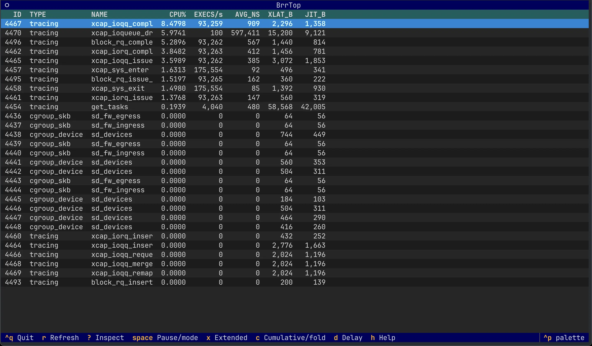
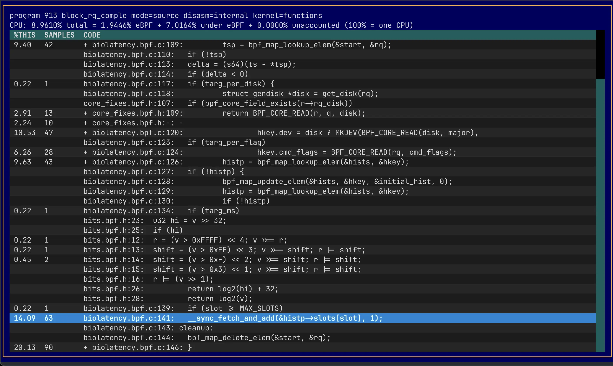
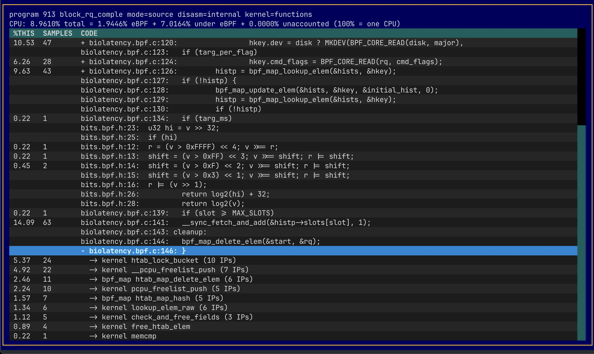
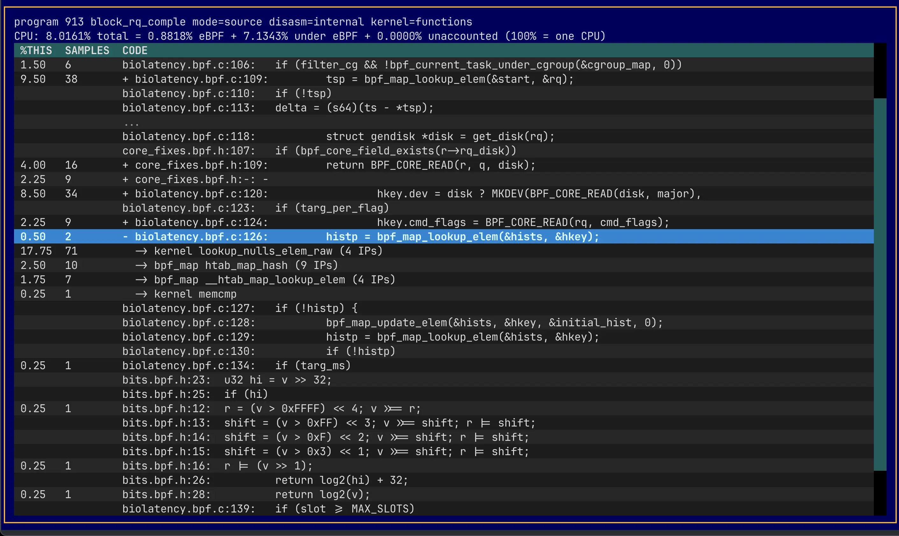
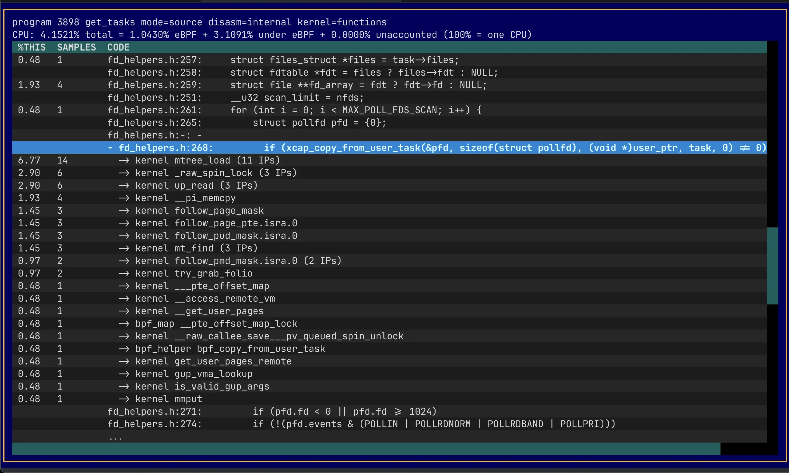
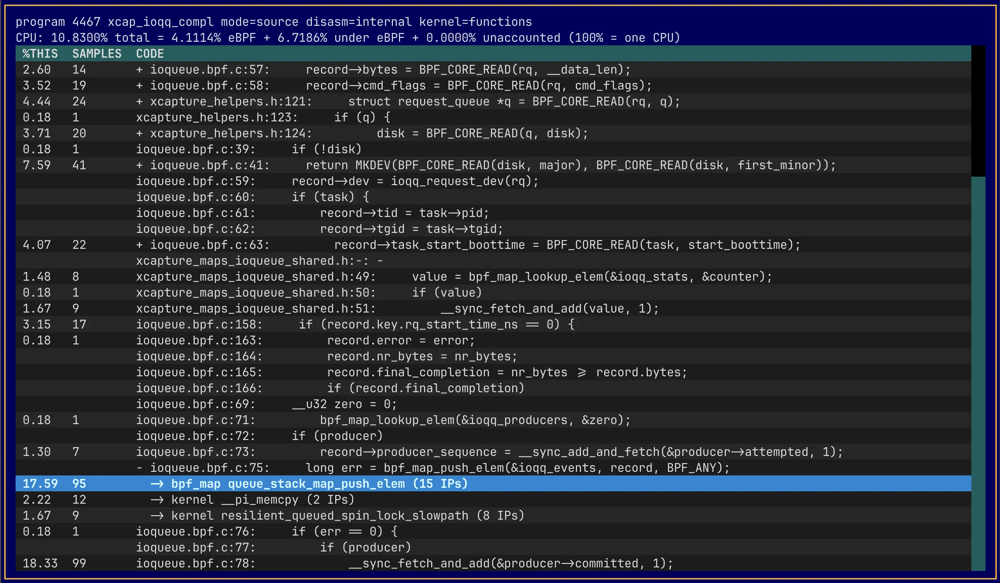

# brr — eBPF Runtime Reporter and Profiler

`brr` is a tool that gives you _bpftop_-like initial listing of eBPF program activity, with the ability to thenk press ENTER for seeing the source code lines of a program and press "p" to profile the eBPF program using `perf_events` sampling.

It has both a plain-text, JSON, CSV CLI output mode and a top-like TUI mode. It lists loaded eBPF objects, measures program activity, maps CPU samples
back to BPF source lines, and importantly also shows any kernel work triggered underneath eBPF programs.

`brr` talks directly to the kernel through `bpf()` and `perf_event_open()`. It does not depend on the `perf` command.

*Live program activity, execution rate, average runtime, and JIT size:*

[](docs/images/brr-list.webp)

*Source-level CPU attribution, including time spent in kernel functions called from the selected BPF program:*

[](docs/images/brr-1.webp)

*Expand a source line to see which kernel functions account for work underneath the BPF program:*

[](docs/images/brr-2.webp)


[More screenshots](#more-screenshots)

## Install / build

Most commands require root or equivalent Linux capabilities. Published
standalone binaries include Python and the application dependencies and require
Linux with GLIBC 2.28 or newer.

### Standalone binary

ARM64 (`aarch64`):

```bash
curl -fL -o brr https://github.com/tanelpoder/brr/releases/download/v0.6.1/brr-0.6.1-linux-aarch64 && chmod +x brr
```

x86-64 (`x86_64`):

```bash
curl -fL -o brr https://github.com/tanelpoder/brr/releases/download/v0.6.1/brr-0.6.1-linux-x86_64 && chmod +x brr
```

Run it from the current directory or install it on `PATH`:

```bash
sudo ./brr
sudo install -m 0755 brr /usr/local/bin/brr
sudo brr
```

### RPM and DEB packages

| Platform | RPM | DEB |
| --- | --- | --- |
| ARM64 | [`brr-0.6.1-1.el8.aarch64.rpm`](https://github.com/tanelpoder/brr/releases/download/v0.6.1/brr-0.6.1-1.el8.aarch64.rpm) | [`brr_0.6.1-1_arm64.deb`](https://github.com/tanelpoder/brr/releases/download/v0.6.1/brr_0.6.1-1_arm64.deb) |
| x86-64 | [`brr-0.6.1-1.el8.x86_64.rpm`](https://github.com/tanelpoder/brr/releases/download/v0.6.1/brr-0.6.1-1.el8.x86_64.rpm) | [`brr_0.6.1-1_amd64.deb`](https://github.com/tanelpoder/brr/releases/download/v0.6.1/brr_0.6.1-1_amd64.deb) |

The release also includes a combined
[`SHA256SUMS`](https://github.com/tanelpoder/brr/releases/download/v0.6.1/SHA256SUMS)
manifest for all six binaries and packages.

Install a downloaded package with `dnf` or `apt`:

```bash
sudo dnf install ./brr-0.6.1-1.el8.aarch64.rpm
sudo apt install ./brr_0.6.1-1_arm64.deb
```

Use the matching x86-64 package name on Intel and AMD 64-bit systems.

### Run from source

Source checkouts require Linux, Python 3.11 or newer, and
[`uv`](https://docs.astral.sh/uv/getting-started/installation/).

```bash
git clone https://github.com/tanelpoder/brr.git
cd brr
uv sync
sudo env PATH="$PATH" uv run brr
```

### Build release artifacts

Build the GLIBC 2.28-compatible standalone binary, RPM, and DEB natively for the
current architecture with Docker or Podman:

```bash
scripts/build_rhel8_release.sh
```

For a simpler build that targets the current host's GLIBC:

```bash
uv sync --group dev --group package
uv run --group package python scripts/build_release.py --all
```

See [PACKAGING.md](PACKAGING.md) for release dependencies, compatibility
checks, artifact verification, and the native multi-architecture GitHub
release workflow.

## Quick start

Open the interactive TUI:

```bash
sudo brr
```

List loaded programs and other BPF objects:

```bash
sudo brr prog
sudo brr map
sudo brr link
sudo brr btf
```

Measure activity or profile BPF JIT execution:

```bash
sudo brr activity --duration 2
sudo brr profile --duration 5
sudo brr profile --kernel-samples
```

Use `brr --help` or `brr <command> --help` for all options. Plain text, JSON,
and CSV output are available for scripting; the interactive TUI is also
available as deterministic text output with `brr top --textmode`.

## What brr shows

- Loaded BPF programs, maps, links, BTF objects, JIT sizes, and pinned paths.
- Program execution counts, average runtime, CPU usage, and cumulative metrics.
- Translated BPF instructions annotated with source metadata when available.
- Perf samples attributed to BPF source lines and to helper or kernel functions
  running underneath them.
- Capture-loss and perf-buffer telemetry for judging profile completeness.

`bpftool` is optional and used only for explicit enrichment or comparison.
`brr` scopes runtime statistics with `BPF_ENABLE_STATS` and does not write to
`/proc/sys/kernel/bpf_stats_enabled`.

For richer text reports, see [EXAMPLE_OUTPUT.md](EXAMPLE_OUTPUT.md). For the
sampling methodology and measured comparisons with `perf`, see
[Correctness validation against perf](docs/perf-correctness-validation.md).

## More screenshots

Profiling drilldown makes hash-map lookup and comparison costs visible:

[](docs/images/brr-3.webp)

Sleepable programs can expose user-memory access, page walking, and locking
costs:

[](docs/images/brr-4.webp)

Queue-map pushes can reveal copying and lock contention below the calling BPF
source line:

[](docs/images/brr-5.webp)
